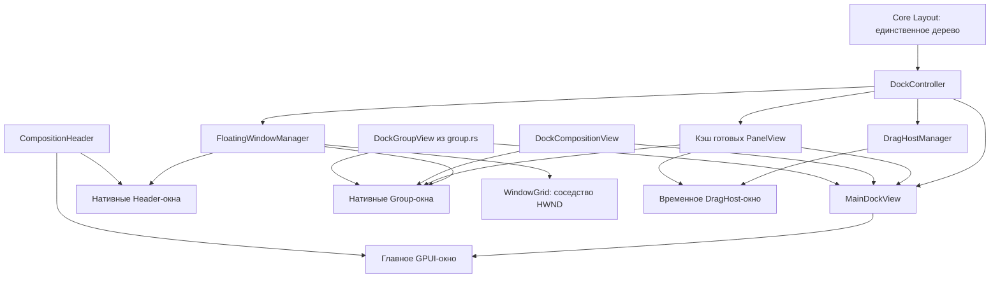
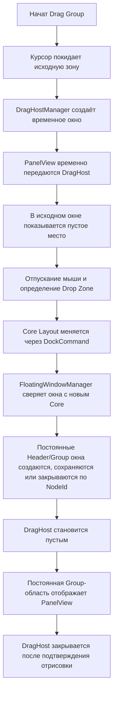

# Черновик архитектуры Docking: объекты, сетка и Floating-окна

> Статус: черновик по объяснениям пользователя от 17 ноября 2026 года.
>
> Это фиксация текущего понимания и задумок, а не утверждённая техническая спецификация. Неизвестные места специально оставлены открытыми. Код пока не меняем.

## 1. От чего отталкиваемся

В текущем представлении есть два основных визуальных объекта:

- `crates/dock-gpui/src/dock-components/group.rs` — отображение Group с вкладками.
- `crates/dock-gpui/src/dock-components/composition_header.rs` — отображение шапки Composition.

Для этих объектов существует (или должна быть выделена) общая функция/механизм создания Floating-окон. Он должен учитывать режим отображения:

- **Main:** Header просто рисуется внутри основного окна; отдельное нативное окно для Header не создаётся.
- **Floating:** для Header создаётся отдельное нативное окно, когда оно требуется по сценарию.
- **Перетаскивание Group:** для перетаскиваемой Group создаётся отдельное окно с уже готовым компонентом из `group.rs`.

Важно: речь идёт о повторном использовании готового компонента, а не о создании другой реализации Group специально для перетаскивания.

## 2. Что уже существует в текущем коде (проверено)

Первоначальная идея с отдельной Grid и примером «векторов» была только способом объяснить расположение элементов. Это не требование к Rust-структурам. После проверки исходников отдельную логическую Grid создавать не нужно: дерево расположения уже хранится в Core и является единственным источником истины.

### Логическая структура Core

- `dock-core::Layout` владеет всеми узлами дерева, областями DockArea, плавающими областями FloatingGroup и данными панелей.
- `DockArea` содержит ссылку `root` на корневой узел дерева, а не собственную копию колонок и групп.
- `Node` может быть `Split`, `Column`, `Tabs` или `Panel`. Узлы ссылаются друг на друга через `NodeId`.
- `Split` задаёт расположение детей по оси: `Axis::X` — слева направо, `Axis::Y` — сверху вниз.
- `Column` содержит упорядоченный список Group и их вертикальные пропорции. Group — это узел `Tabs`, а вкладки ведут к узлам Panel.
- `FloatingGroup` хранит сведения о плавающей области: ссылку на DockArea, положение/размер и порядок наложения. Само дерево остаётся в `Layout`.

Упрощённо это выглядит так:

```text
Layout
├── Main DockArea (Left)
│   └── root
│       └── Split (Axis::X, если колонок несколько)
│           ├── Column
│           │   ├── Group (Tabs)
│           │   │   ├── Panel
│           │   │   └── Panel
│           │   └── Group (Tabs)
│           └── Column
│               └── Group (Tabs)
├── Main DockArea (Right)
└── FloatingGroup
    └── DockArea -> root -> Split/Column -> Group -> Tabs -> Panel
```

### Кто за что отвечает в GPUI

- `DockController` владеет одним экземпляром `dock_core::Layout`, геометрией/кэшем и состоянием взаимодействия. Он также хранит кэш готовых `AnyView` для открытых PanelId; представления панелей используются повторно при переносе между окнами.
- `DockHost` связывает контроллер с главным окном и создаёт/подключает два менеджера: `FloatingWindowManager` и `DragHostManager`. Оба менеджера используют тот же `DockController`.
- `MainDockView` получает геометрию из Core и рисует колонки в главном GPUI-окне. Второго дерева колонок и групп он не хранит.
- `DockCompositionView` — общий путь отображения колонок. Он передаёт группы в `DockGroupView`.
- `DockGroupView` из `dock-components/group.rs` используется как в Main, так и в отдельных Floating-окнах. Компонент группы уже общий.
- `CompositionHeader` из `dock-components/composition_header.rs` тоже общий. Разница между Main и Floating сейчас заключается в том, какие колонки ему передают и в каком окне он рисуется.

### Чем сейчас отличаются Main и Floating

**Main:** шапка рисуется внутри главного окна. В текущем коде создаётся одна общая шапка для каждой Main DockArea (Left и Right), а не отдельная шапка для каждой колонки. Её зона перетаскивания запускает перенос всей DockArea со всеми её колонками. Это подтверждается тем, что жест создаёт `DragPayload::DockArea { side }`.

**Floating:** `FloatingWindowManager` создаёт отдельное нативное окно для шапки каждой Core-колонки и отдельное нативное окно для каждой Group. Поэтому одна Floating-колонка из двух Group сейчас представлена тремя HWND: Header, Group 1 и Group 2.

### Что такое WindowGrid

`WindowGrid` в `dock-gpui/src/window_chain.rs` — это не логическая Grid приложения. Он хранит связи между настоящими нативными окнами ОС: какое окно находится слева, справа, выше или ниже другого.

Его участники имеют идентификаторы `Header(NodeId)` и `Group(NodeId)`; старый `FloatingComposition(FloatingGroupId)` оставлен как переходная совместимость. Внутренние связи Header → Group менеджер восстанавливает по текущему дереву Core. То есть Core отвечает на вопрос «что с чем связано в Docking», а WindowGrid — «как отдельные окна расположены относительно друг друга на экране».

### Что такое DragHost

`DragHostManager` управляет одним временным окном на время одного перетаскивания. Он не владеет Core Layout и не создаёт новые PanelView. Он временно размещает уже существующие представления панелей, переданные через общий `DockController`.

При успешном переносе во Floating сейчас применяется двухфазная передача: DragHost сначала перестаёт показывать переносимое содержимое и рисует пустую заглушку; затем постоянные окна Group получают те же представления панелей и отрисовывают их; после этого временный DragHost закрывается. Код прямо не использует DragHost как постоянное окно Group.

## 3. Схема текущей архитектуры

### Источник данных, отображение и нативные окна



Здесь нет отдельного хранилища Grid для колонок и групп. Также WindowGrid не заменяет Core: это отдельная схема расположения физических окон.

### Текущий путь переноса Group во Floating



Эта схема описывает текущий путь переноса содержимого во Floating. При переносе в Main DragHost закрывается после применения результата, а содержимое снова отображает главное окно.

### Что это означает для первоначального замысла

- Отдельная логическая Grid поверх Core не нужна и создала бы риск двух источников истины. Для колонок, групп и их порядка следует использовать уже существующее дерево `Layout`.
- `WindowGrid` стоит сохранять в его фактической роли: связи между физическими окнами Floating. Не расширять его до второго дерева Docking.
- Общие компоненты `DockGroupView` и `CompositionHeader` уже существуют. Их нужно развивать и переиспользовать, а не делать отдельные копии для Main, Floating и Drag.
- Текущая Main-шапка представляет целую DockArea, а не одну колонку. Это отличается от требования перетаскивать отдельную колонку за её шапку; перед реализацией такого поведения потребуется изменить/уточнить саму точку захвата и область, которую она представляет.
- При переносе Group сейчас используется временное DragHost-окно. Оно не становится постоянным окном Group. Сохранение именно того же HWND при переносе — отдельное требование, которое текущий механизм DragHost сам по себе не выполняет.
- В Floating постоянные окна идентифицируются через Core NodeId. Если после команды перемещения нужный Group сохраняет тот же NodeId и остаётся Floating-частью, менеджер может сохранить её постоянное окно; если узел исчезает из Floating-дерева или сливается в другую Group, окно удаляется. Это нужно отличать от перемещения DragHost за курсором.

## 4. Жизненный цикл Group при перетаскивании

Предварительно пользователь видит процесс так:

1. Начинается перетаскивание Group.
2. Вызывается механизм создания Floating-окна для Group.
3. В окно передаётся готовый компонент из `group.rs`.
4. Это окно сопровождает Group во время перетаскивания.
5. После отпускания мыши определяется результат: стыковка с Drop Zone или создание самостоятельной Floating-композиции.

Есть намерение не уничтожать это окно при успешной стыковке, а сохранить его и сделать частью принимающей композиции. То есть принимающая композиция должна принять существующее окно Group, а не обязательно закрывать его и создавать новое.

### Что остаётся на исходном месте во время Drag

Общее правило для перетаскивания Group из **Main** и **Floating**:

- На исходном месте остаётся **пустое пространство** — сама перетаскиваемая Group там не отображается.
- Исходная **полоса вкладок остаётся Drop Zone**: пользователь может вернуть Group обратно обычным перетаскиванием мышью, отпустив её на эту полосу.
- Отмена через **Esc** возвращает Group в исходное место, которое сохранялось на время перетаскивания.

Дополнительное уточнение для многогрупповой Floating-колонки: во время Drag соседние окна остаются неподвижны. Только после успешного отпускания мыши они сдвигаются снизу вверх к Header, закрывая свободный слот. Существующее окно перетаскиваемой Group можно перемещать вместо создания второго окна; пустой слот не требует отдельного окна-заглушки.

Если Group отпускают вне всех Drop Zones и она становится самостоятельным Floating-элементом, временное пустое место в исходной композиции убирается. Main перераспределяет освободившееся пространство по описанным выше правилам: при удалении средней Group пространство делят две соседние группы, при удалении крайней — растягиваются все оставшиеся группы.

Пока предполагаем, что такое перераспределение происходит автоматически, «по умолчанию», без отдельной специальной логики. Это предварительное предположение, его ещё нужно проверить на практике.

Техническая реализация сохранения исходной позиции, пустого пространства и возможности возврата ещё не определена.

### Если из исходной колонки забрали Group

Поведение зависит от режима:

- **Floating:** каждая Group отображается в отдельном окне. После извлечения одной Group оставшиеся окна Group сдвигаются снизу вверх, заполняя освободившееся место в направлении шапки `CompositionHeader`. Пустого промежутка между окнами не остаётся.
- **Main:** если извлекаемая Group находится между двумя соседними Group, их границы сдвигаются одновременно: освободившееся пространство делится примерно поровну между соседями, и обе группы расширяются в освободившуюся область. Если извлекается крайняя (верхняя или нижняя) Group, освободившееся пространство распределяется между всеми оставшимися Group — растягиваются все группы, а не только ближайшая. Это пока описание наблюдаемого поведения Photoshop; не выяснено, обеспечивает такое перераспределение сам движок/контейнер по умолчанию или специальная логика приложения.

Если после переноса в исходной Floating-колонке не осталось ни одной Group, эта колонка закрывается вместе со своим окном `CompositionHeader`. Пустая колонка без групп не остаётся.

Техническая реализуемость и детали передачи/перепривязки нативного окна пока не проверены. Важно отдельно различать сохранение самой Group/её состояния и сохранение того же нативного окна ОС.

### Перетаскивание целой колонки

Если пользователь берёт мышью за `CompositionHeader`, перетаскивается **вся колонка как единое целое**, включая все принадлежащие ей Group.

Это действие доступно в обоих режимах:

- **Main:** захват выполняется за нарисованный компонент `composition_header.rs`. Вместе с ним перемещаются все Group этой колонки.
- **Floating:** захват выполняется за окно `CompositionHeader`; вместе с ним перемещаются все окна Group этой колонки.

Во время перемещения колонка сохраняет взаимное расположение Header и всех Group. Отдельные Group не отрываются от колонки и не перемещаются независимо друг от друга в рамках этого действия.

Для целой колонки доступны все Drop Zones, кроме **полосы вкладок**. Полоса вкладок предназначена для приёма отдельной Group; целую колонку через неё не вставляем.

#### Перенос одной Group из многогрупповой Floating-колонки в Main
После успешного переноса Group в Main её отдельное нативное окно закрывается при любом варианте Drop Zone. Если Group была отпущена на полосу вкладок, её вкладки уже добавлены в принимающую Group, поэтому отдельное окно источника также закрывается.


Для отдельной Group доступны те же зоны Main, что и при переносе целой колонки, и дополнительно **полоса вкладок**:

- Если в Main несколько колонок — доступны боковые зоны слева, справа и между существующими колонками.
- Если в Main одна колонка — доступны зоны слева и справа от колонки, а также сверху, между Group и снизу относительно её Group.
- **Полоса вкладок:** все вкладки перетаскиваемой Group добавляются в конец полосы вкладок принимающей Group. Их исходный порядок сохраняется.
  
Таким образом, полоса вкладок — единственное дополнительное место назначения для отдельной Group; для целой колонки эта зона остаётся запрещённой.

#### Перенос целой колонки из Floating в Main
После успешной стыковки Floating-колонки в Main её отдельные нативные окна закрываются: окно `CompositionHeader` и окна всех входивших в колонку `Group`. Содержимое/структура колонки теперь отображается внутри Main, где отдельные нативные окна для этих элементов не используются. Это правило относится к переходу Floating → Main и не отменяет отдельно описанное сохранение окон при стыковке между Floating-композициями.


Доступные Drop Zones зависят от того, сколько колонок уже находится в Main:

- **Если в Main несколько колонок:** целую Floating-колонку можно пристыковать слева, справа или между существующими колонками.
- **Если в Main одна колонка:** доступны боковые зоны слева и справа от этой колонки, а также вертикальные зоны относительно её Group — сверху, между Group и снизу.
- **Полоса вкладок исключена** в обоих случаях: целую колонку через неё вставить нельзя.

Это фиксирует доступные направления стыковки. Точное поведение размеров и перераспределения пространства при этих операциях в Main ещё предстоит отдельно описать.

#### Перетаскивание Group из одной Floating-композиции в другую

Здесь поведение зависит от того, сколько Group находится в исходной Floating-колонке.

- **В исходной колонке только одна Group:** во время перетаскивания перемещается вся пара `CompositionHeader + Group` как единое целое. Header не убирается в начале Drag. После отпускания действуют те же правила, что и при переносе целой колонки:
  - **Верхняя или нижняя Drop Zone:** окно Header закрывается, а Group входит в стек принимающей колонки.
  - **Левая или правая Drop Zone:** Header остаётся, и пара `CompositionHeader + Group` становится самостоятельной соседней колонкой.
- **В исходной колонке несколько Group:** перетаскивается только выбранная Group. Её существующее окно Group используется для перетаскивания — отдельное новое нативное окно только ради Drag и пустого места не создаётся. Пока мышь удерживается, остальные окна Group исходной колонки остаются на своих местах; освободившийся слот остаётся пустым. После успешного отпускания мыши оставшиеся окна Group сдвигаются снизу вверх, в сторону `CompositionHeader`, закрывая пустое место. Исходная зона вкладок остаётся доступной для возврата Group мышью, а `Esc` возвращает её в сохранённое исходное положение.

Таким образом, пустое место — это временно незанятый слот/область в расположении Grid, а не дополнительное нативное окно. Исходные координаты и позиция Group должны сохраняться на время Drag. Если Drag отменён или Group возвращена в исходную зону, окно возвращается на прежнее место, а соседние окна не должны оставаться сдвинутыми.

#### Перенос одной Group из многогрупповой Floating-колонки в другую Floating-композицию

Для отдельной Group доступны все Drop Zones принимающей Floating-композиции, включая **полосу вкладок**. То есть правила выбора зон такие же, как при переносе отдельной Group из Floating в Main, но применяются к Floating-получателю.

- При отпускании на верхнюю, междугрупповую или нижнюю зону Group присоединяется к соответствующему месту стека принимающей колонки.
- При отпускании на левую или правую зону Group становится отдельной колонкой: для неё сохраняется/создаётся собственный Header.
- При отпускании на полосу вкладок вкладки перетаскиваемой Group добавляются в конец принимающей Group, сохраняя исходный порядок.

При отпускании в одну из зон стыковки (верхняя, междугрупповая, нижняя, левая или правая) существующее окно перетаскиваемой Group сохраняется и становится частью принимающей Floating-композиции; отдельное новое окно для этой Group создавать не требуется.

При отпускании на полосу вкладок все вкладки перетаскиваемой Group добавляются в конец принимающей Group с сохранением исходного порядка. После переноса вкладок отдельное окно исходной Group закрывается, поскольку оно больше не содержит вкладок.

Если исходная колонка после переноса осталась без Group, она закрывается вместе со своим Header. Если в ней остались другие Group, после успешного отпускания они сдвигаются снизу вверх к Header, закрывая освободившееся место.

#### Вставка целой колонки в Floating

При переносе колонки в Floating сохраняется исходный порядок всех Group внутри переносимой колонки. Дальнейшее поведение зависит от Drop Zone:

- **Верхняя Drop Zone:** Group переносимой колонки вставляются сверху в стек принимающей колонки; существующие окна Group принимающей колонки сдвигаются вниз, освобождая для них место.
- **Нижняя Drop Zone:** Group переносимой колонки вставляются снизу в стек принимающей колонки; существующие окна Group принимающей колонки не сдвигаются.
- При отпускании мыши в верхней или нижней Drop Zone окно `CompositionHeader` переносимой колонки закрывается. Её Group становятся частью стека принимающей колонки, а отдельный Header для них больше не нужен.
- **Левая или правая Drop Zone:** переносимая колонка остаётся самостоятельной соседней колонкой. Она сохраняется как отдельный набор окон: собственное окно `CompositionHeader` и все принадлежащие ей окна `Group`. Порядок Group внутри неё сохраняется.

Это правило пока зафиксировано для Floating. Поведение аналогичной операции в Main ещё не описано.

### Перенос целой колонки из Main в уже существующую Floating-композицию

Для целой колонки, перетаскиваемой из Main за её нарисованный `CompositionHeader`, в существующую Floating-композицию действуют те же правила Drop Zones, что и при переносе целой колонки между Floating-композициями:

- **Верхняя или нижняя Drop Zone:** все Group переносимой колонки входят в стек принимающей Floating-колонки, сохраняя свой порядок. Окно `CompositionHeader` переносимой колонки закрывается.
- **Левая или правая Drop Zone:** переносимая колонка становится отдельной соседней Floating-колонкой. Для неё создаётся собственное окно `CompositionHeader`, а все её Group сохраняются как отдельные окна в исходном порядке.
- **Полоса вкладок исключена:** целую колонку нельзя сбросить на полосу вкладок.

После успешного переноса временное пустое место в Main убирается, а Main перераспределяет пространство по ранее описанным правилам. При отмене через `Esc` вся колонка возвращается в исходное положение.

- **Отпускание вне всех Drop Zones:** переносимая колонка становится самостоятельной Floating-колонкой. Для неё создаётся отдельное нативное окно `CompositionHeader` и отдельные нативные окна для всех её Group. Сохраняются порядок Group и их взаимное расположение.

### Перенос Group из Main в уже существующую Floating-композицию

Для Group, которую вытянули из Main и перетаскивают в уже существующую Floating-композицию, действуют те же Drop Zones и результаты, что и при переносе отдельной Group между Floating-композициями:

- **Верхняя, междугрупповая или нижняя Drop Zone:** Group добавляется в соответствующее место стека принимающей колонки. Созданное для Drag окно Group становится её окном в принимающей Floating-композиции; отдельное второе окно не создаётся.
- **Левая или правая Drop Zone:** создаётся отдельная соседняя Floating-колонка из этой Group. Для неё создаётся собственное окно `CompositionHeader`, а окно Group сохраняется.
- **Полоса вкладок:** вкладки перетаскиваемой Group добавляются в конец принимающей Group с сохранением исходного порядка. После объединения пустое окно перетаскиваемой Group закрывается.

После успешной стыковки временное пустое место в Main убирается, а Main перераспределяет пространство по ранее описанным правилам. Если Drag отменён через `Esc` или Group возвращена на исходную полосу вкладок, она возвращается на прежнее место без завершения переноса.

### Создание Header при отделении Group из Main во Floating

Если Group отпущена вне всех Drop Zones и становится самостоятельной Floating-колонкой, после отпускания мыши над окном Group создаётся отдельное окно `CompositionHeader`.

При начале отделения Group из Main её Floating-окно получает последний фактический размер исходной Group. **На протяжении всего перетаскивания этот размер сохраняется**: высота и ширина не пересчитываются из-за содержимого вкладки, а окно не меняет размер под курсором.

Пересчёт размеров выполняется **после отпускания мыши**. Тогда размер Floating-окна подбирается с учётом минимальных параметров активной вкладки. Если активная вкладка требует большую минимальную ширину или высоту, окно автоматически увеличивается до необходимых значений, даже если пользователь до этого вручную уменьшил окно.

При последующем переключении вкладки размеры также пересчитываются по минимальным параметрам новой активной вкладки; поэтому могут изменяться и высота, и ширина.

Минимальные параметры будут задаваться для каждой панели при её создании с учётом предназначенного ей функционала. На текущем этапе используются уже существующие в проекте минимальные параметры; новую систему задания этих значений сейчас не проектируем.

Ширина окна Header должна быть **равна текущей ширине окна Group**. Header располагается непосредственно над Group, формируя колонку из двух выровненных по ширине окон. Когда после отпускания мыши или переключения вкладки меняется ширина Group, ширина Header также подстраивается.

## 5. Когда создавать окно CompositionHeader

Окно `CompositionHeader` не нужно создавать в начале каждого перетаскивания Group.

По текущему правилу:

- Если Group отпущена на верхнюю Drop Zone группы — окно Header не создаётся.
- Если Group отпущена между группами — окно Header не создаётся.
- Если Group отпущена на нижнюю Drop Zone группы — окно Header не создаётся.
- Если Group отпущена на полосу вкладок — окно Header не создаётся.
- В остальных случаях после отпускания мыши создаётся отдельное окно Header над окном Group.

Таким образом, отдельное окно Header появляется тогда, когда результатом операции должна стать самостоятельная Floating-композиция/колонка, а не при обычной стыковке с перечисленными зонами.

Точную классификацию всех остальных зон и граничных случаев ещё предстоит согласовать.

## 6. Нативные окна ОС и внутренний режим

### Что работает в текущем коде

`FloatingWindowManager` создаёт для Floating отдельные нативные окна Header и Group. Если создание конкретного такого окна завершается ошибкой, сейчас менеджер записывает ошибку и не создаёт для этой части внутреннюю замену.

В текущей реализации не найден готовый режим, который автоматически заменяет недоступные нативные окна внутренним отображением через `z-index`. Это пока требование на будущее, а не существующая возможность.

### Требование на будущее

Если платформа не поддерживает дополнительные окна или их создание недоступно, Docking должен сохранить то же логическое поведение, но отображать Header и Group внутри окна приложения. При этом:

- Core Layout остаётся единственным источником структуры;
- используются те же компоненты `CompositionHeader` и `DockGroupView`;
- порядок наложения внутренних поверхностей управляется отдельно от логического дерева;
- логика перемещения и Drop Zone остаётся общей, а не дублируется для внутреннего режима.

Способ обнаружения недоступности нативных окон и переключения на внутреннее отображение ещё не спроектирован.

## 7. Что пока не решено

Текущая проверка кода прояснила часть архитектуры, но выявила несколько важных различий между тем, что уже реализовано, и желаемым поведением:

1. **Шапка Main:** сейчас одна общая шапка на всю левую/правую DockArea и перетаскивание всей области. В желаемом поведении фигурирует захват конкретной колонки. Нужно согласовать и спроектировать переход от текущей точки захвата к нужному поведению.
2. **Сохранение нативного окна Group:** нужно определить, в каких сценариях требуется сохранить именно существующий HWND перетаскиваемой Group, а в каких допустимо закрыть его и создать постоянное окно на новом месте. Это особенно важно для Main → Floating и Floating → Floating.
3. **Временный DragHost для Floating-источника:** сейчас при извлечении Group из Floating тоже используется отдельный временный DragHost. В желаемом поведении Group должна перемещаться своим существующим окном, без лишнего окна-переносчика. Нужно спроектировать этот путь отдельно.
4. **Слияние в принимающую Group:** при сбросе на полосу вкладок источник превращается в часть уже существующей Group. Нужно проверить, как должны завершаться судьбы исходного Group HWND и его NodeId после такого слияния.
5. **Перераспределение пустого места в Main:** описанные правила расширения соседних групп зафиксированы как желаемое поведение, но пока не подтверждено, какая часть уже обеспечивается Core, а какая потребует явной команды/расчёта.
6. **Внутренний режим без HWND:** концепция есть, реализации автоматического fallback пока нет.
7. **Отмена перетаскивания:** нужно отдельно сверить для каждого источника, что Esc и возврат на исходную полосу восстанавливают исходное положение и не оставляют сдвинутые окна/пустые промежутки.

Вопрос «нужна ли отдельная логическая Grid поверх Core» больше не открыт: по текущему устройству проекта это было бы дублированием. Для логической структуры используем `Layout`; `WindowGrid` остаётся моделью физических соседств нативных окон.

## 8. Порядок дальнейшего обсуждения

Дальше не меняем код, пока не будет понятна целевая схема. Предлагаемый порядок:

1. Сопоставить текущий и желаемый жизненный цикл одной Group при переносе Main → Floating.
2. Отдельно разобрать Floating → Floating: как перемещается существующее окно Group и когда сдвигаются соседние окна.
3. Разобрать перенос целой колонки и отличие текущей общей Main-шапки от требуемого захвата колонки.
4. После этого свести все сценарии в одну целевую схему объектов, окон и передачи содержимого.
5. Только затем подготовить короткие этапы реализации с чёткими границами файлов и поведением для каждого этапа.

Сценарий Main → Main по-прежнему отложен до тех пор, пока остальные сценарии не будут работать.
---

## Принцип на этом этапе

Сначала описываем ожидаемое поведение и согласовываем архитектуру. Только после этого рисуем итоговую схему и возвращаемся к коду. Текущий этап не предполагает изменения исходников или тестов.
