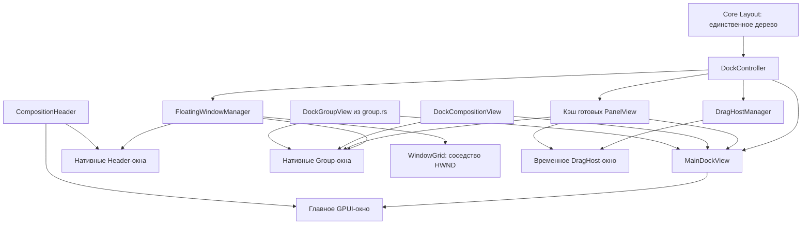
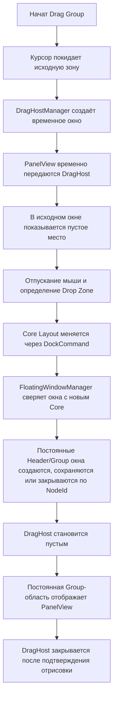
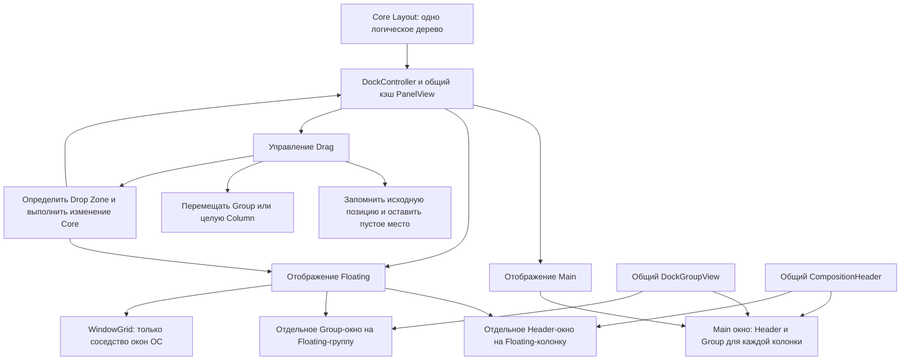
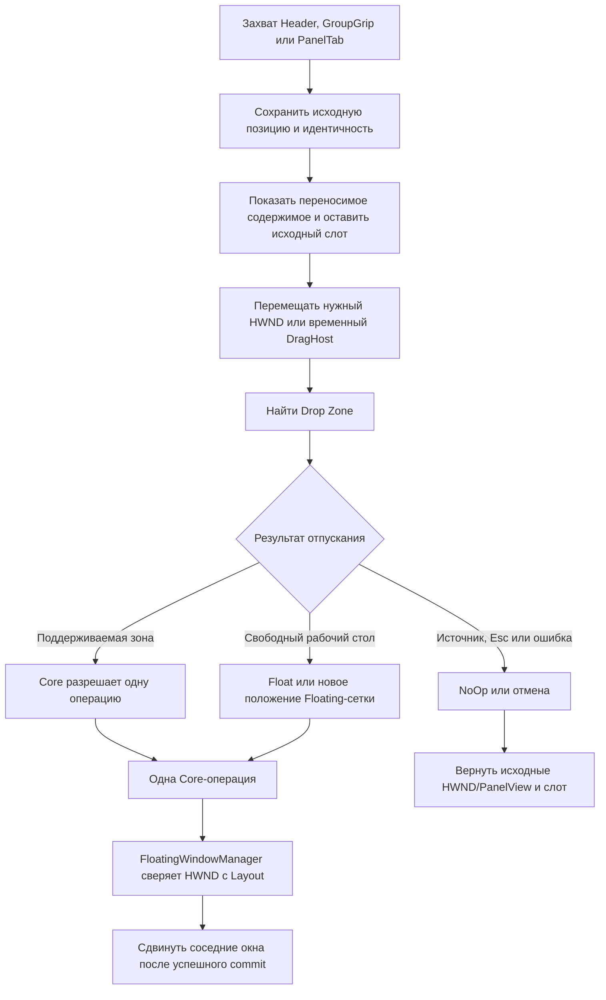

# Черновик архитектуры Docking: объекты, сетка и Floating-окна

> Статус: черновик по объяснениям пользователя от 17 ноября 2026 года.
>
> Это фиксация текущего понимания и задумок, а не утверждённая техническая спецификация. Неизвестные места специально оставлены открытыми. Код пока не меняем.

## 1. От чего отталкиваемся

В текущем представлении есть два основных визуальных объекта:

- `crates/dock-gpui/src/dock-components/group.rs` — отображение Group с вкладками.
- `crates/dock-gpui/src/dock-components/composition_header.rs` — отображение шапки Composition.

Для этих объектов существует (или должна быть выделена) общая функция/механизм создания Floating-окон. Он должен учитывать режим отображения:

- **Main:** Header просто рисуется внутри основного окна; отдельное нативное окно для Header не создаётся.
- **Floating:** для Header создаётся отдельное нативное окно, когда оно требуется по сценарию.
- **Перетаскивание Group:** для перетаскиваемой Group создаётся отдельное окно с уже готовым компонентом из `group.rs`.

Важно: речь идёт о повторном использовании готового компонента, а не о создании другой реализации Group специально для перетаскивания.

## 2. Что уже существует в текущем коде (проверено)

Первоначальная идея с отдельной Grid и примером «векторов» была только способом объяснить расположение элементов. Это не требование к Rust-структурам. После проверки исходников отдельную логическую Grid создавать не нужно: дерево расположения уже хранится в Core и является единственным источником истины.

### Логическая структура Core

- `dock-core::Layout` владеет всеми узлами дерева, областями DockArea, плавающими областями FloatingGroup и данными панелей.
- `DockArea` содержит ссылку `root` на корневой узел дерева, а не собственную копию колонок и групп.
- `Node` может быть `Split`, `Column`, `Tabs` или `Panel`. Узлы ссылаются друг на друга через `NodeId`.
- `Split` задаёт расположение детей по оси: `Axis::X` — слева направо, `Axis::Y` — сверху вниз.
- `Column` содержит упорядоченный список Group и их вертикальные пропорции. Group — это узел `Tabs`, а вкладки ведут к узлам Panel.
- `FloatingGroup` хранит сведения о плавающей области: ссылку на DockArea, положение/размер и порядок наложения. Само дерево остаётся в `Layout`.

Упрощённо это выглядит так:

```text
Layout
├── Main DockArea (Left)
│   └── root
│       └── Split (Axis::X, если колонок несколько)
│           ├── Column
│           │   ├── Group (Tabs)
│           │   │   ├── Panel
│           │   │   └── Panel
│           │   └── Group (Tabs)
│           └── Column
│               └── Group (Tabs)
├── Main DockArea (Right)
└── FloatingGroup
    └── DockArea -> root -> Split/Column -> Group -> Tabs -> Panel
```

### Кто за что отвечает в GPUI

- `DockController` владеет одним экземпляром `dock_core::Layout`, геометрией/кэшем и состоянием взаимодействия. Он также хранит кэш готовых `AnyView` для открытых PanelId; представления панелей используются повторно при переносе между окнами.
- `DockHost` связывает контроллер с главным окном и создаёт/подключает два менеджера: `FloatingWindowManager` и `DragHostManager`. Оба менеджера используют тот же `DockController`.
- `MainDockView` получает геометрию из Core и рисует колонки в главном GPUI-окне. Второго дерева колонок и групп он не хранит.
- `DockCompositionView` — общий путь отображения колонок. Он передаёт группы в `DockGroupView`.
- `DockGroupView` из `dock-components/group.rs` используется как в Main, так и в отдельных Floating-окнах. Компонент группы уже общий.
- `CompositionHeader` из `dock-components/composition_header.rs` тоже общий. Разница между Main и Floating сейчас заключается в том, какие колонки ему передают и в каком окне он рисуется.

### Чем сейчас отличаются Main и Floating

**Main:** шапка рисуется внутри главного окна. Сейчас создаётся одна общая шапка на каждую Main DockArea (Left и Right), а не отдельная шапка для каждой колонки. Её drag-зона запускает перенос всей DockArea со всеми колонками через `DragPayload::DockArea { side }`.

**Floating:** `FloatingWindowManager` создаёт отдельное нативное окно для шапки каждой Core-колонки и отдельное нативное окно для каждой Group. Поэтому одна Floating-колонка из двух Group сейчас представлена тремя HWND: Header, Group 1 и Group 2.

### Уточнённое правило шапок для целевой архитектуры

В Main и Floating шапка отображается **у каждой Column отдельно**. При этом поведение свободной части шапок одинаковое и относится к целой связанной сетке:

- Свободная drag-зона есть в шапке каждой колонки. Захват в любой из этих зон перемещает **всю связанную сетку**, а не только колонку под указателем. В Main это все колонки соответствующей DockArea; во Floating — все окна, соединённые в один WindowGrid.
- Кнопка `<<` принадлежит только своей колонке, отображается в её шапке и сворачивает только эту колонку.
- Кнопки `X` в Main нет вообще.
- Во Floating кнопка `X` отображается ровно один раз — на крайнем правом краю всей связанной сетки, в шапке самой правой колонки. Она закрывает **всю сетку**, включая все её колонки и группы.
- Кнопки `<<` и `X`, а также разделители колонок не входят в drag-зону.

Таким образом, у каждой колонки своя шапка и свой `<<`, но свободные drag-зоны всех шапок одной сетки имеют общий смысл и переносят сетку целиком. Это не создаёт отдельную логическую Grid: состав колонок берётся из Core, а состав связанной группы нативных окон — из WindowGrid.

### Что такое WindowGrid

`WindowGrid` в `dock-gpui/src/window_chain.rs` — это не логическая Grid приложения. Он хранит связи между настоящими нативными окнами ОС: какое окно находится слева, справа, выше или ниже другого.

Его участники имеют идентификаторы `Header(NodeId)` и `Group(NodeId)`; старый `FloatingComposition(FloatingGroupId)` оставлен как переходная совместимость. Внутренние связи Header → Group менеджер восстанавливает по текущему дереву Core. То есть Core отвечает на вопрос «что с чем связано в Docking», а WindowGrid — «как отдельные окна расположены относительно друг друга на экране».

### Что такое DragHost

`DragHostManager` управляет одним временным окном на время одного перетаскивания. Он не владеет Core Layout и не создаёт новые PanelView. Он временно размещает уже существующие представления панелей, переданные через общий `DockController`.

При успешном переносе во Floating сейчас применяется двухфазная передача: DragHost сначала перестаёт показывать переносимое содержимое и рисует пустую заглушку; затем постоянные окна Group получают те же представления панелей и отрисовывают их; после этого временный DragHost закрывается. Код прямо не использует DragHost как постоянное окно Group.

## 3. Схема текущей архитектуры

### Источник данных, отображение и нативные окна



Здесь нет отдельного хранилища Grid для колонок и групп. Также WindowGrid не заменяет Core: это отдельная схема расположения физических окон.

### Текущий путь переноса Group во Floating



Эта схема описывает текущий путь переноса содержимого во Floating. При переносе в Main DragHost закрывается после применения результата, а содержимое снова отображает главное окно.

### Что это означает для первоначального замысла

- Отдельная логическая Grid поверх Core не нужна и создала бы риск двух источников истины. Для колонок, групп и их порядка следует использовать уже существующее дерево `Layout`.
- `WindowGrid` стоит сохранять в его фактической роли: связи между физическими окнами Floating. Не расширять его до второго дерева Docking.
- Общие компоненты `DockGroupView` и `CompositionHeader` уже существуют. Их нужно развивать и переиспользовать, а не делать отдельные копии для Main, Floating и Drag.
- Текущая Main-шапка представляет целую DockArea, а не одну колонку. Это отличается от требования перетаскивать отдельную колонку за её шапку; перед реализацией такого поведения потребуется изменить/уточнить саму точку захвата и область, которую она представляет.
- При переносе Group сейчас используется временное DragHost-окно. Оно не становится постоянным окном Group. Сохранение именно того же HWND при переносе — отдельное требование, которое текущий механизм DragHost сам по себе не выполняет.
- В Floating постоянные окна идентифицируются через Core NodeId. Если после команды перемещения нужный Group сохраняет тот же NodeId и остаётся Floating-частью, менеджер может сохранить её постоянное окно; если узел исчезает из Floating-дерева или сливается в другую Group, окно удаляется. Это нужно отличать от перемещения DragHost за курсором.

### Направление целевой архитектуры (концепция, не техническое решение)

Эта схема показывает, как должны сочетаться уже существующие объекты и согласованные правила поведения. Подписи описывают роли, а не названия новых Rust-структур или файлов.



Основные правила этого направления:

- Колонки, группы, их порядок и принадлежность хранятся только в Core Layout. Отдельная логическая Grid не появляется.
- `DockGroupView` и `CompositionHeader` остаются общими компонентами. Меняется место их отображения, но не создаётся отдельная реализация для каждого режима.
- Main отображает отдельный Header над каждой Column. Свободная drag-зона любого такого Header запускает перенос всей Main DockArea (всей её сетки); `<<` действует только на свою Column, а `X` отсутствует.
- Floating отображает каждый Header и каждую Group отдельным нативным окном. Свободная drag-зона любого Header перемещает всю связанную WindowGrid-сетку. `<<` действует только на свою Column, а единственная `X` находится на крайнем правом краю и закрывает всю сетку.
- При переносе Group из Floating используется её существующее окно, а не ещё одно временное окно-переносчик. При переносе из Main временная поверхность с общим Group-компонентом после успешного отделения может стать постоянным окном этой Group — это желаемый результат, но способ передачи HWND ещё не выбран.
- При сбросе на полосу вкладок отдельная Group перестаёт существовать как самостоятельная группа: её вкладки добавляются в принимающую Group, а исходное отдельное окно закрывается.
- Перестановка и стыковка изменяют Core Layout одной командой; менеджер окон затем приводит реальные окна в соответствие с новым деревом.

Эта концепция не определяет пока внутреннее устройство Drag-сессии, точные API менеджеров и механизм передачи HWND. Эти детали будем выводить из существующего кода после согласования каждого сценария.
## 4. Жизненный цикл Group при перетаскивании

Предварительно пользователь видит процесс так:

1. Начинается перетаскивание Group.
2. Вызывается механизм создания Floating-окна для Group.
3. В окно передаётся готовый компонент из `group.rs`.
4. Это окно сопровождает Group во время перетаскивания.
5. После отпускания мыши определяется результат: стыковка с Drop Zone или создание самостоятельной Floating-композиции.

Есть намерение не уничтожать это окно при успешной стыковке, а сохранить его и сделать частью принимающей композиции. То есть принимающая композиция должна принять существующее окно Group, а не обязательно закрывать его и создавать новое.

### Что остаётся на исходном месте во время Drag

Общее правило для перетаскивания Group из **Main** и **Floating**:

- На исходном месте остаётся **пустое пространство** — сама перетаскиваемая Group там не отображается.
- Исходная **полоса вкладок остаётся Drop Zone**: пользователь может вернуть Group обратно обычным перетаскиванием мышью, отпустив её на эту полосу.
- Отмена через **Esc** возвращает Group в исходное место, которое сохранялось на время перетаскивания.

Дополнительное уточнение для многогрупповой Floating-колонки: во время Drag соседние окна остаются неподвижны. Только после успешного отпускания мыши они сдвигаются снизу вверх к Header, закрывая свободный слот. Существующее окно перетаскиваемой Group можно перемещать вместо создания второго окна; пустой слот не требует отдельного окна-заглушки.

Если Group отпускают вне всех Drop Zones и она становится самостоятельным Floating-элементом, временное пустое место в исходной композиции убирается. Main перераспределяет освободившееся пространство по описанным выше правилам: при удалении средней Group пространство делят две соседние группы, при удалении крайней — растягиваются все оставшиеся группы.

Пока предполагаем, что такое перераспределение происходит автоматически, «по умолчанию», без отдельной специальной логики. Это предварительное предположение, его ещё нужно проверить на практике.

Техническая реализация сохранения исходной позиции, пустого пространства и возможности возврата ещё не определена.

### Если из исходной колонки забрали Group

Поведение зависит от режима:

- **Floating:** каждая Group отображается в отдельном окне. После извлечения одной Group оставшиеся окна Group сдвигаются снизу вверх, заполняя освободившееся место в направлении шапки `CompositionHeader`. Пустого промежутка между окнами не остаётся.
- **Main:** если извлекаемая Group находится между двумя соседними Group, их границы сдвигаются одновременно: освободившееся пространство делится примерно поровну между соседями, и обе группы расширяются в освободившуюся область. Если извлекается крайняя (верхняя или нижняя) Group, освободившееся пространство распределяется между всеми оставшимися Group — растягиваются все группы, а не только ближайшая. Это пока описание наблюдаемого поведения Photoshop; не выяснено, обеспечивает такое перераспределение сам движок/контейнер по умолчанию или специальная логика приложения.

Если после переноса в исходной Floating-колонке не осталось ни одной Group, эта колонка закрывается вместе со своим окном `CompositionHeader`. Пустая колонка без групп не остаётся.

Техническая реализуемость и детали передачи/перепривязки нативного окна пока не проверены. Важно отдельно различать сохранение самой Group/её состояния и сохранение того же нативного окна ОС.

### Общая drag-зона шапок связанной сетки

У каждой Column есть собственная шапка, но свободная область каждой шапки входит в одну общую drag-зону связанной сетки.

- **Main:** для каждой Column рисуется отдельная шапка. Захват свободной области любой из шапок перемещает всю сетку данной Main DockArea со всеми её колонками и Group. Все такие зоны используют один и тот же смысл перетаскивания.
- **Floating:** у каждой Column есть отдельное нативное окно Header. Захват свободной области любого Header перемещает всю связанную WindowGrid-сетку: все её Header и Group сохраняют взаимное расположение.
- **Кнопка `<<`:** отдельная для каждой Column; сворачивает только свою Column и не запускает Drag.
- **Кнопка `X`:** в Main отсутствует. Во Floating одна кнопка располагается на крайнем правом краю всей WindowGrid-сетки и закрывает всю сетку целиком.

Во время движения сетка сохраняет взаимное расположение всех колонок, Header и Group. Полоса вкладок, кнопки и разделители не становятся частью общей drag-зоны. Для переноса целой сетки доступны зоны стыковки, кроме полосы вкладок: она предназначена для отдельной Group.

Это правило заменяет прежнее предположение, что Header каждой отдельной колонки всегда перемещает только эту колонку.
**Уточнение единицы перемещения:** свободная часть Header никогда не означает захват только своей Column. Она захватывает всю композицию, к которой принадлежит Header: Main DockArea целиком или всю Floating WindowGrid. Поэтому описанные ниже операции «переноса целой колонки за Header» относятся только к случаю, когда исходная сетка фактически состоит из одной Column. Для нескольких колонок Header перемещает всю сетку; отдельный перенос Group выполняется через GroupGrip.

#### Перенос одной Group из многогрупповой Floating-колонки в Main
После успешного переноса Group в Main её отдельное нативное окно закрывается при любом варианте Drop Zone. Если Group была отпущена на полосу вкладок, её вкладки уже добавлены в принимающую Group, поэтому отдельное окно источника также закрывается.


Для отдельной Group доступны те же зоны Main, что и при переносе целой колонки, и дополнительно **полоса вкладок**:

- Если в Main несколько колонок — доступны боковые зоны слева, справа и между существующими колонками.
- Если в Main одна колонка — доступны зоны слева и справа от колонки, а также сверху, между Group и снизу относительно её Group.
- **Полоса вкладок:** все вкладки перетаскиваемой Group добавляются в конец полосы вкладок принимающей Group. Их исходный порядок сохраняется.
  
Таким образом, полоса вкладок — единственное дополнительное место назначения для отдельной Group; для целой колонки эта зона остаётся запрещённой.

#### Перенос целой колонки из Floating в Main
После успешной стыковки Floating-колонки в Main её отдельные нативные окна закрываются: окно `CompositionHeader` и окна всех входивших в колонку `Group`. Содержимое/структура колонки теперь отображается внутри Main, где отдельные нативные окна для этих элементов не используются. Это правило относится к переходу Floating → Main и не отменяет отдельно описанное сохранение окон при стыковке между Floating-композициями.


Доступные Drop Zones зависят от того, сколько колонок уже находится в Main:

- **Если в Main несколько колонок:** целую Floating-колонку можно пристыковать слева, справа или между существующими колонками.
- **Если в Main одна колонка:** доступны боковые зоны слева и справа от этой колонки, а также вертикальные зоны относительно её Group — сверху, между Group и снизу.
- **Полоса вкладок исключена** в обоих случаях: целую колонку через неё вставить нельзя.

Это фиксирует доступные направления стыковки. Точное поведение размеров и перераспределения пространства при этих операциях в Main ещё предстоит отдельно описать.

#### Перетаскивание Group из одной Floating-композиции в другую

Здесь поведение зависит от того, сколько Group находится в исходной Floating-колонке.

- **В исходной колонке только одна Group:** во время перетаскивания перемещается вся пара `CompositionHeader + Group` как единое целое. Header не убирается в начале Drag. После отпускания действуют те же правила, что и при переносе целой колонки:
  - **Верхняя или нижняя Drop Zone:** окно Header закрывается, а Group входит в стек принимающей колонки.
  - **Левая или правая Drop Zone:** Header остаётся, и пара `CompositionHeader + Group` становится самостоятельной соседней колонкой.
- **В исходной колонке несколько Group:** перетаскивается только выбранная Group. Её существующее окно Group используется для перетаскивания — отдельное новое нативное окно только ради Drag и пустого места не создаётся. Пока мышь удерживается, остальные окна Group исходной колонки остаются на своих местах; освободившийся слот остаётся пустым. После успешного отпускания мыши оставшиеся окна Group сдвигаются снизу вверх, в сторону `CompositionHeader`, закрывая пустое место. Исходная зона вкладок остаётся доступной для возврата Group мышью, а `Esc` возвращает её в сохранённое исходное положение.

Таким образом, пустое место — это временно незанятый слот/область в расположении Grid, а не дополнительное нативное окно. Исходные координаты и позиция Group должны сохраняться на время Drag. Если Drag отменён или Group возвращена в исходную зону, окно возвращается на прежнее место, а соседние окна не должны оставаться сдвинутыми.

#### Перенос одной Group из многогрупповой Floating-колонки в другую Floating-композицию

Для отдельной Group доступны все Drop Zones принимающей Floating-композиции, включая **полосу вкладок**. То есть правила выбора зон такие же, как при переносе отдельной Group из Floating в Main, но применяются к Floating-получателю.

- При отпускании на верхнюю, междугрупповую или нижнюю зону Group присоединяется к соответствующему месту стека принимающей колонки.
- При отпускании на левую или правую зону Group становится отдельной колонкой: для неё сохраняется/создаётся собственный Header.
- При отпускании на полосу вкладок вкладки перетаскиваемой Group добавляются в конец принимающей Group, сохраняя исходный порядок.

При отпускании в одну из зон стыковки (верхняя, междугрупповая, нижняя, левая или правая) существующее окно перетаскиваемой Group сохраняется и становится частью принимающей Floating-композиции; отдельное новое окно для этой Group создавать не требуется.

При отпускании на полосу вкладок все вкладки перетаскиваемой Group добавляются в конец принимающей Group с сохранением исходного порядка. После переноса вкладок отдельное окно исходной Group закрывается, поскольку оно больше не содержит вкладок.

Если исходная колонка после переноса осталась без Group, она закрывается вместе со своим Header. Если в ней остались другие Group, после успешного отпускания они сдвигаются снизу вверх к Header, закрывая освободившееся место.

#### Вставка целой колонки в Floating

При переносе колонки в Floating сохраняется исходный порядок всех Group внутри переносимой колонки. Дальнейшее поведение зависит от Drop Zone:

- **Верхняя Drop Zone:** Group переносимой колонки вставляются сверху в стек принимающей колонки; существующие окна Group принимающей колонки сдвигаются вниз, освобождая для них место.
- **Нижняя Drop Zone:** Group переносимой колонки вставляются снизу в стек принимающей колонки; существующие окна Group принимающей колонки не сдвигаются.
- При отпускании мыши в верхней или нижней Drop Zone окно `CompositionHeader` переносимой колонки закрывается. Её Group становятся частью стека принимающей колонки, а отдельный Header для них больше не нужен.
- **Левая или правая Drop Zone:** переносимая колонка остаётся самостоятельной соседней колонкой. Она сохраняется как отдельный набор окон: собственное окно `CompositionHeader` и все принадлежащие ей окна `Group`. Порядок Group внутри неё сохраняется.

Это правило пока зафиксировано для Floating. Поведение аналогичной операции в Main ещё не описано.

### Перенос целой колонки из Main в уже существующую Floating-композицию

Для целой колонки, перетаскиваемой из Main за её нарисованный `CompositionHeader`, в существующую Floating-композицию действуют те же правила Drop Zones, что и при переносе целой колонки между Floating-композициями:

- **Верхняя или нижняя Drop Zone:** все Group переносимой колонки входят в стек принимающей Floating-колонки, сохраняя свой порядок. Окно `CompositionHeader` переносимой колонки закрывается.
- **Левая или правая Drop Zone:** переносимая колонка становится отдельной соседней Floating-колонкой. Для неё создаётся собственное окно `CompositionHeader`, а все её Group сохраняются как отдельные окна в исходном порядке.
- **Полоса вкладок исключена:** целую колонку нельзя сбросить на полосу вкладок.

После успешного переноса временное пустое место в Main убирается, а Main перераспределяет пространство по ранее описанным правилам. При отмене через `Esc` вся колонка возвращается в исходное положение.

- **Отпускание вне всех Drop Zones:** переносимая колонка становится самостоятельной Floating-колонкой. Для неё создаётся отдельное нативное окно `CompositionHeader` и отдельные нативные окна для всех её Group. Сохраняются порядок Group и их взаимное расположение.

### Перенос Group из Main в уже существующую Floating-композицию

Для Group, которую вытянули из Main и перетаскивают в уже существующую Floating-композицию, действуют те же Drop Zones и результаты, что и при переносе отдельной Group между Floating-композициями:

- **Верхняя, междугрупповая или нижняя Drop Zone:** Group добавляется в соответствующее место стека принимающей колонки. Созданное для Drag окно Group становится её окном в принимающей Floating-композиции; отдельное второе окно не создаётся.
- **Левая или правая Drop Zone:** создаётся отдельная соседняя Floating-колонка из этой Group. Для неё создаётся собственное окно `CompositionHeader`, а окно Group сохраняется.
- **Полоса вкладок:** вкладки перетаскиваемой Group добавляются в конец принимающей Group с сохранением исходного порядка. После объединения пустое окно перетаскиваемой Group закрывается.

После успешной стыковки временное пустое место в Main убирается, а Main перераспределяет пространство по ранее описанным правилам. Если Drag отменён через `Esc` или Group возвращена на исходную полосу вкладок, она возвращается на прежнее место без завершения переноса.

### Создание Header при отделении Group из Main во Floating

Если Group отпущена вне всех Drop Zones и становится самостоятельной Floating-колонкой, после отпускания мыши над окном Group создаётся отдельное окно `CompositionHeader`.

При начале отделения Group из Main её Floating-окно получает последний фактический размер исходной Group. **На протяжении всего перетаскивания этот размер сохраняется**: высота и ширина не пересчитываются из-за содержимого вкладки, а окно не меняет размер под курсором.

Пересчёт размеров выполняется **после отпускания мыши**. Тогда размер Floating-окна подбирается с учётом минимальных параметров активной вкладки. Если активная вкладка требует большую минимальную ширину или высоту, окно автоматически увеличивается до необходимых значений, даже если пользователь до этого вручную уменьшил окно.

При последующем переключении вкладки размеры также пересчитываются по минимальным параметрам новой активной вкладки; поэтому могут изменяться и высота, и ширина.

Минимальные параметры будут задаваться для каждой панели при её создании с учётом предназначенного ей функционала. На текущем этапе используются уже существующие в проекте минимальные параметры; новую систему задания этих значений сейчас не проектируем.

Ширина окна Header должна быть **равна текущей ширине окна Group**. Header располагается непосредственно над Group, формируя колонку из двух выровненных по ширине окон. Когда после отпускания мыши или переключения вкладки меняется ширина Group, ширина Header также подстраивается.

## 5. Когда создавать окно CompositionHeader

Окно `CompositionHeader` не нужно создавать в начале каждого перетаскивания Group.

По текущему правилу:

- Если Group отпущена на верхнюю Drop Zone группы — окно Header не создаётся.
- Если Group отпущена между группами — окно Header не создаётся.
- Если Group отпущена на нижнюю Drop Zone группы — окно Header не создаётся.
- Если Group отпущена на полосу вкладок — окно Header не создаётся.
- В остальных случаях после отпускания мыши создаётся отдельное окно Header над окном Group.

Таким образом, отдельное окно Header появляется тогда, когда результатом операции должна стать самостоятельная Floating-композиция/колонка, а не при обычной стыковке с перечисленными зонами.

Точную классификацию всех остальных зон и граничных случаев ещё предстоит согласовать.

## 6. Нативные окна ОС и внутренний режим

### Что работает в текущем коде

`FloatingWindowManager` создаёт для Floating отдельные нативные окна Header и Group. Если создание конкретного такого окна завершается ошибкой, сейчас менеджер записывает ошибку и не создаёт для этой части внутреннюю замену.

В текущей реализации не найден готовый режим, который автоматически заменяет недоступные нативные окна внутренним отображением через `z-index`. Это пока требование на будущее, а не существующая возможность.

### Требование на будущее

Если платформа не поддерживает дополнительные окна или их создание недоступно, Docking должен сохранить то же логическое поведение, но отображать Header и Group внутри окна приложения. При этом:

- Core Layout остаётся единственным источником структуры;
- используются те же компоненты `CompositionHeader` и `DockGroupView`;
- порядок наложения внутренних поверхностей управляется отдельно от логического дерева;
- логика перемещения и Drop Zone остаётся общей, а не дублируется для внутреннего режима.

Способ обнаружения недоступности нативных окон и переключения на внутреннее отображение ещё не спроектирован.

## 7. Проверка Floating → Floating по текущему коду

### Как сейчас начинается перенос Group

В `components/floating.rs` перетаскивание за GroupGrip или за вкладку сначала начинается в исходном Floating-окне. Когда указатель выходит за область исходной Group или попадает на другое окно, запускается `DragHostManager`.

Далее:

- создаётся временное окно DragHost;
- представления PanelView передаются временному окну через общий `DockController`;
- постоянное окно исходной Group скрывается на время передачи;
- исходная Core-раскладка до отпускания мыши остаётся прежней, поэтому соседние Group не должны сдвигаться раньше времени;
- после отпускания временный DragHost передаёт PanelView постоянным Group-окнам и закрывается.

Это не соответствует целевому требованию для Floating-источника: перетаскиваться должно существующее окно Group, без отдельного окна-переносчика. Исходный Group HWND сейчас не следует за курсором, а скрывается; поэтому он не может одновременно оставаться движущейся поверхностью и доступной исходной зоной возврата.

### Как сейчас обрабатываются зоны другой Floating-композиции

В `drag_host_manager.rs` функция `floating_window_chain_target` перехватывает боковые зоны другой Floating-композиции. Для верхней, нижней, левой и правой границы она подменяет Core-цель на `FreeArea`: создаётся отдельная Core FloatingGroup, а её нативные окна связываются с окнами получателя через `WindowGrid`.

В результате два окна физически располагаются рядом или одно над другим, но их логические Core-композиции остаются отдельными. Это отличается от согласованного поведения:

- верх/низ должны вставлять Group в вертикальный стек принимающей Column;
- лево/право должны создавать Column внутри целевой Floating-композиции;
- при вертикальной вставке отдельный Header источника больше не нужен;
- при горизонтальной вставке Group получает собственный Header.

Сброс на полосу вкладок идёт по другому пути: он не превращается в WindowGrid-соединение, а передаётся Core для слияния вкладок. Это ближе к требуемому поведению.

### Важное: Core уже содержит нужные операции для Group

Проверка `dock-core/src/layout/drop_handling.rs` и `group_operations.rs` показала, что логические операции для GroupGrip уже существуют:

- `GroupTabs` разрешается в `MergeGroup`: вкладки источника объединяются с принимающей Group;
- `GroupEdge::Top/Bottom` разрешается в `SplitGroup`: Group переносится в нужное место вертикального стека принимающей Column;
- `GroupEdge::Left/Right` разрешается в `SplitGroup`: для переносимой Group создаётся новая Column рядом с целевой;
- `FloatingColumnInsertion` создаёт Column на внутренней границе горизонтальной Floating-композиции.

При этих операциях сам узел Group переносится, а не копируется. Его `NodeId` остаётся той же идентичностью. Нормализация Layout убирает опустевшие Column и Floating-области. Поэтому логические правила не нужно дублировать в GPUI или в отдельной Grid.

Текущее расхождение возникает выше Core: обработчик переноса в GPUI подменяет часть правильных Core-целей на `FreeArea` и физические связи WindowGrid. Направление переделки — вернуть разрешение GroupGrip Drop Zones в Core, одновременно изменив транспорт Group на перемещение её постоянного HWND.

### Перетаскивание Header целой Floating-колонки

Для захвата Header уже есть отдельный нативный путь: `begin_existing_column_move` собирает окно Header и все окна Group конкретной Column и двигает их вместе.

Но этот путь не проверяет Drop Zones во время движения. При отпускании он вызывает `finish_floating_column_move_in`: корневая Column только меняет координаты, а Column внутри горизонтальной композиции отделяется в новую Floating-композицию. Стыковка с другой Floating-композицией в этом обработчике пока не выполняется.

Кроме того, `begin_existing_column_move` собирает только Header и Group одной Column. Это соответствует нынешнему поведению, но не новому общему правилу шапок: в целевой архитектуре захват свободной зоны любого Header должен перемещать **всю связанную WindowGrid-сетку**. Для этого нужно переиспользовать/обобщить сбор связанных окон через WindowGrid, а не оставлять перемещение только на уровне одной Column.

Специальный путь `begin_single_tab_window_move` не решает задачу одиночной Group в общем виде: он доступен только когда во всей Floating-композиции одна Group и одна вкладка. Нужное правило зависит от числа Group в Column, а не от количества вкладок внутри Group.

### Закрытие Floating WindowGrid кнопкой X

Кнопка X относится не к одному HWND и не к одному FloatingGroup: она закрывает всю физически связанную WindowGrid. Нажатие на единственную X в правой крайней шапке должно закрывать все Core Floating-области, представленные окнами этой сетки.

Проверка текущего кода:

- CloseCompositionButton::render_with_metrics только рисует символ. Обработчика нажатия в компоненте нет.
- CompositionHeader::render сейчас добавляет X при каждом вызове. Для целевого поведения это нужно параметризовать: Main — без X; Floating — только у правой крайней Header всей WindowGrid.
- Core уже содержит DockCommand::CloseFloatingGroup { group }. В layout/floating_operations.rs команда удаляет FloatingGroup, её DockArea и всё поддерево с панелями.
- Одна WindowGrid может включать несколько Core FloatingGroup. В GPUI уже есть WindowGridRegistry::members_for, который возвращает все связанные Header/Group окна, и part_members_by_group, который связывает эти окна с их FloatingGroup.
- Поэтому обработчик X должен получить все связанные WindowGrid members, по part_members_by_group собрать уникальные FloatingGroupId и передать набор CloseFloatingGroup в существующий DockController::dispatch_sequence_in. Последовательность применяется через history.apply_sequence, то есть все закрытия входят в одну Core-операцию.
- После изменения Layout уже существующий reconcile_part_windows удаляет ставшие ненужными HWND, а WindowGridRegistry::retain_members очищает исчезнувшие связи. Отдельный механизм закрытия нативных окон не нужен.

Итого: переиспользуем Core-команду закрытия, WindowGridRegistry, part_members_by_group и штатную сверку окон с Layout. Новую модель состава сетки не вводим.

Пользовательское поведение подтверждено: X полностью закрывает всю Floating WindowGrid. Все FloatingGroup этой сетки и все принадлежащие им панели удаляются из текущей раскладки; панели не возвращаются в Main. Это соответствует существующей Core-команде CloseFloatingGroup, применённой ко всем группам сетки одной последовательностью.

### Отмена перетаскивания и возврат в исходную область

Здесь важно разделять три исхода жеста: успешное стыковочное действие, успешное отделение/перемещение без стыковки и настоящую отмену. Отпускание вне зоны не всегда означает отмену.

**Что уже делает текущий код:**

- При переносе Panel, Group или Main DockArea через DragHost исходный Core Layout не меняется во время движения. Временно передаются только существующие PanelView. При Escape или отмене DragHost закрывается, `finish_panel_view_transfer` возвращает представления исходному Host, а исходная раскладка остаётся прежней.
- При завершении без DropTarget Core не создаёт команду для Panel/Group/DockArea. Для сброса на прежнее место Core также умеет выдавать `DragDropAction::NoOp`: например, для Group на саму себя, на прежнюю границу соседней Group или в исходный слот; для вкладки на прежнюю позицию. Это не меняет Layout и его версию.
- При настоящем Drop Core-команда применяется только после разрешения цели. Если команда отклонена, исходная раскладка сохраняется; DragHost закрывается и отдаёт PanelView постоянному Host.
- Для нативного перемещения Floating-окон `FloatingWindowManager` сохраняет `cancel_origin` каждого HWND. При Escape `cancel_native_move` отменяет Core history transaction и возвращает каждое окно в сохранённую физическую позицию. При ошибке финального commit Core-транзакция отменяется, а сверка окон восстанавливает их bounds по Layout.

**Целевое поведение для всех сценариев:**

1. `Esc`, потеря pointer capture, недействительные координаты или ошибка подготовки Drop означают отмену. Возвращаются исходные HWND/PanelView, исходный порядок Group и исходные координаты. Core Layout не меняется.
2. Если GroupGrip возвращается в собственную исходную Group/полосу, перенос отменяется: сохраняются исходный Group NodeId, его место в Column и исходное окно. Нельзя создавать новую Floating-композицию, выполнять Merge с самим собой или сдвигать соседей.
3. Для PanelTab возврат на прежнюю позицию — `NoOp`. Перемещение на другую позицию той же полосы остаётся обычной перестановкой вкладки.
4. При переносе Group из Floating исходная ячейка остаётся зарезервированной визуально, пока Drop не принят. При отмене окно Group возвращается в неё; соседние Group не сдвигаются. При успешном Drop Core сначала подтверждает новое дерево, и только после этого менеджер убирает пустое место и переставляет соседние окна.
5. Отпускание на свободном рабочем столе может быть успешным отделением: Panel/Group из Main или Floating создаёт самостоятельное Floating-окно; целая уже плавающая WindowGrid остаётся в новом положении. Это не отмена.
6. Отпускание на чужом окне без поддерживаемой Drop-зоны не должно терять содержимое: для Panel/Group жест отменяется и возвращается к источнику. Для Main DockArea существует отдельное правило tear-off: отпускание за пределами управляемых окон создаёт Floating-композицию.

**Что требуется при переходе с DragHost на прямое перемещение существующего Group HWND:**

- Перенести в сессию Group drag те же исходные данные, которые уже собираются для native move: HWND и его исходные физические координаты, плюс Core-идентичность Group и исходный слот в Column.
- Не менять Core Layout и не уплотнять соседей до успешного Drop.
- На Escape/ошибке вернуть тот же HWND к сохранённым координатам, очистить preview и оставить исходное дерево без изменений.
- После принятого Drop сохранить HWND по Group NodeId, обновить его FloatingGroup-владельца и геометрию, затем выполнить перестановку оставшихся окон.

Таким образом, существующие механизмы отмены уже есть в двух местах: возврат PanelView после DragHost и возврат нативных окон по `cancel_origin` с отменой Core transaction. Новая реализация должна объединить эти гарантии для прямого перемещения Group HWND, а не создавать третью независимую систему восстановления.

### Сведение сценариев в одну целевую схему

Это сводка согласованных правил. Она описывает поведение без привязки к новым Rust-структурам.

**1. Единственное логическое дерево**

```text
DockController
└── dock_core::Layout
    ├── Main DockArea Left
    │   └── Split(X) из Column (если колонок несколько)
    │       └── Column → упорядоченные Group → Tabs → Panel
    ├── Main DockArea Right
    └── FloatingGroup
        └── DockArea → root
            └── Column или Split(X) из Column
                └── Column → упорядоченные Group → Tabs → Panel
```

`Layout` хранит порядок и принадлежность элементов. Отдельное логическое дерево Grid не создаётся. `DockController` остаётся владельцем Layout и общего кэша PanelView.

**2. Отображение и настоящие окна**

- Main: `MainDockView` рисует Header и Group для каждой Column внутри главного окна. `<<` действует только на свою Column. `X` отсутствует.
- Floating: `FloatingWindowManager` поддерживает отдельный HWND для каждой Header-колонки и для каждой Group. `WindowGrid` хранит физическое соседство этих HWND и следует за структурой Core.
- Main и Floating используют одни и те же `CompositionHeader` и `DockGroupView`; отдельные версии компонентов для перетаскивания не создаются.
- `DragHost` — временная поверхность для переноса содержимого из Main. При переносе из Floating целевая схема использует уже существующий HWND Group.

**3. Что именно перемещается при захвате**

| Захват | Единица перемещения |
|---|---|
| Свободная область любого Main Header | Вся соответствующая Main DockArea со всеми её колонками и Group |
| Свободная область любого Floating Header | Вся связанная Floating WindowGrid со всеми Header и Group |
| `GroupGrip` в Main | Одна Group; исходное место временно остаётся пустым |
| `GroupGrip` во Floating, если в Column несколько Group | Только выбранная Group и её существующий HWND; соседние окна ждут успешного Drop |
| `GroupGrip` во Floating, если в Column одна Group | Пара Header + Group как единое целое, независимо от числа вкладок |
| `PanelTab` | Одна вкладка, не вся Group |
| `<<` | Только сворачивание своей Column, не Drag |
| `X` во Floating | Полное закрытие всей связанной WindowGrid вместе со всеми её панелями |

У всех свободных зон Header один смысл. Чтобы переместить только Group, используется GroupGrip, а не свободная область Header.

**4. Что происходит при отпускании**

- На верхнюю/нижнюю зону или между Group: переносимая Group входит в нужное место вертикального стека целевой Column. Сохраняется исходный порядок вкладок.
- На левую/правую зону: если переносится самостоятельная колонка или пара Header + единственная Group, она становится соседней Column со своим Header. Для Group из многогрупповой колонки набор допустимых зон определяется её отдельным сценарием; нельзя автоматически считать Group целой колонкой.
- На TabStrip целевой Group: вкладки перетаскиваемой Group добавляются в конец в исходном порядке. Исходная Group после слияния больше не существует, поэтому её отдельный HWND закрывается.
- На свободное место рабочего стола: Panel/Group из Main или Floating может стать самостоятельной Floating-композицией; целая плавающая сетка остаётся Floating в новом положении.
- На чужое окно без поддерживаемой Drop Zone: перенос содержимого отменяется, источник восстанавливается.
- После успешной Core-команды менеджер приводит HWND в соответствие с новым Layout: сохраняет существующее окно по NodeId, где это возможно; обновляет его владельца и геометрию; создаёт недостающие Header; закрывает окна узлов, которые были слиты или удалены.

**5. Единый цикл Drag**



До успешного commit исходный слот и исходное дерево не уплотняются. После отмены восстанавливаются те же HWND/PanelView и координаты; после успешного commit менеджер убирает пустое место и перестраивает соседние окна.

**6. Что должно быть общим, а что различается параметрами**

- Общая логика: сохранение исходного положения, определение Drop Zone, передача результата в Core, отмена, восстановление и последующая сверка окон.
- Параметры источника: Main DockArea, Floating WindowGrid, Group или одна вкладка.
- Параметры назначения: Main, Floating, TabStrip или свободное место рабочего стола.
- Различия Main/Floating задают способ отображения и транспортировки HWND/PanelView, но не второе логическое дерево и не отдельные копии правил стыковки.

### Направление целевого поведения для Floating → Floating

1. Если в исходной Column несколько Group — перемещается только HWND выбранной Group. Остальные окна остаются на местах, а исходный слот сохраняется до успешного отпускания.
2. Если в Column одна Group — вместе перемещаются Header и Group как единая пара, независимо от количества вкладок.
3. На отпускании UI передаёт исходный GroupGrip payload и найденную Drop Zone в существующий Core resolver. Core выполняет `SplitGroup` или `MergeGroup`; отдельная логическая Grid не создаётся.
4. После успешного изменения Layout `FloatingWindowManager` сверяет окна с Core: сохраняет окно Group по её NodeId, обновляет принадлежность к Floating-композиции, создаёт или закрывает Header и переставляет оставшиеся окна согласно новой геометрии.
5. При Esc или возврате в исходную зону исходное окно восстанавливает сохранённые координаты; Layout не меняется.

**Обязательное условие для сохранения HWND между разными Floating-композициями:** сейчас `FloatingPartHost` хранит `FloatingGroupId`, переданный при создании, и по нему получает Core-геометрию. В то же время `reconcile_part_windows` сохраняет запись окна по `Group(NodeId)`, если сам NodeId остался в Layout. При переходе Group в другой FloatingGroup сохранения записи по NodeId недостаточно: нужно также обновить владельца окна и источник геометрии. Иначе уже существующий HWND останется связан со старой Floating-композицией. Это отдельная часть задачи, а не автоматическое следствие сохранения NodeId.

Для движения реального HWND потребуется временное состояние перетаскивания в GPUI: исходные координаты, смещение указателя, текущие физические границы окна и цель под курсором. Это состояние жеста, а не второе постоянное дерево Docking.

## 8. Что пока не решено

Текущая проверка кода прояснила часть архитектуры, но выявила несколько важных различий между тем, что уже реализовано, и желаемым поведением:

1. **Общие Header и drag-зоны:** поведение определено. Нужно отрисовать Header для каждой Column, сохранить единую drag-зону всей Main DockArea/Floating WindowGrid, исключить из неё `<<`, `X` и разделители.
2. **Кнопка закрытия Floating-сетки:** поведение подтверждено — одна `X` на крайней правой Header, закрывает все панели всей связанной WindowGrid. Нужно подключить существующие `CloseFloatingGroup` одной последовательностью.
3. **Сохранение HWND между Floating-композициями:** при перемещении Group сохранить её окно по NodeId и обновить FloatingGroup-владельца и источник геометрии.
4. **Переход Main → Floating:** после успешного отделения существующий DragHost желательно превратить в постоянное окно Group, без создания второго HWND и повторной передачи представления.
5. **Слияние Group в TabStrip:** сохранить порядок вкладок, удалить исходную Group из Layout и закрыть только её больше не нужное окно.
6. **Перераспределение пустого места в Main:** уточнить и реализовать расчёт размеров соседних Group после успешного извлечения.
7. **Внутренний режим без HWND:** определить fallback для сценариев, где отдельные нативные окна недоступны.
8. **Отмена перетаскивания:** правила определены в разделе 7. Нужно переиспользовать возврат PanelView после DragHost и восстановление HWND по `cancel_origin` для прямого Group HWND drag.

Вопрос «нужна ли отдельная логическая Grid поверх Core» больше не открыт: по текущему устройству проекта это было бы дублированием. Для логической структуры используем `Layout`; `WindowGrid` остаётся моделью физических соседств нативных окон.

## 9. План реализации по этапам

Схема поведения согласована. Реализацию лучше вести короткими этапами: один законченный сценарий за раз, без параллельной переделки Core и GPUI. В каждом этапе сначала повторно проверяется существующая реализация в указанных файлах; новые механизмы добавляются только там, где старые нельзя обобщить.

### Этап 1. Общая шапка для каждой Column

**Статус:** кодовая часть внесена в `main`; этап ожидает локальной проверки. Сборка и тесты не запускались.

**Основные файлы:**
- `crates/dock-gpui/src/dock-components/composition_header.rs`
- `crates/dock-gpui/src/dock-components/composition_drag_area.rs`
- `crates/dock-gpui/src/dock-components/composition.rs`
- `crates/dock-gpui/src/components/main_dock.rs`
- `crates/dock-gpui/src/components/floating.rs`
- `crates/dock-gpui/src/dock-components/collapse_column_button.rs` и `close_composition_button.rs`

**Что сделать:** перейти от одной общей Main-шапки к отдельной шапке для каждой Column; сохранить общий `CompositionHeader`; сделать показ кнопок параметром режима/положения; `<<` оставить у каждой своей Column; Main `X` не показывать; во Floating подготовить единственную `X` только у правой крайней Header WindowGrid. Свободная часть шапки, `<<`, `X` и разделители должны иметь непересекающиеся зоны.

**Готово, когда:** над каждой Main и Floating Column ровно одна Header; каждая `<<` относится только к своей Column; Main не имеет `X`; во Floating `X` отображается только в крайней правой Header. Пока это только раскладка и hit zones, без изменения логики перемещения.

### Этап 2. Закрытие всей Floating WindowGrid

**Основные файлы:** `crates/dock-gpui/src/dock-components/close_composition_button.rs`, `composition_header.rs`, `crates/dock-gpui/src/floating_manager.rs`, `crates/dock-gpui/src/controller_commands.rs`.

**Что сделать:** подключить нажатие единственной `X` к менеджеру; через уже существующие `WindowGridRegistry::members_for` и `part_members_by_group` собрать все уникальные `FloatingGroupId`; передать `DockCommand::CloseFloatingGroup` для всех найденных областей одним `dispatch_sequence_in`.

**Готово, когда:** одно нажатие `X` закрывает все окна и удаляет все панели одной связанной WindowGrid; панели не возвращаются в Main; никакие другие Floating-сетки не затрагиваются. Повторное нажатие после закрытия не должно приводить к ошибке.

### Этап 3. Перемещение всей сетки за любую Header

**Основные файлы:** `crates/dock-gpui/src/floating_manager.rs`, `window_chain.rs`, `window_chain_geometry.rs`, `components/floating.rs`, `input_drag.rs`; для Main — существующий путь `DragPayload::DockArea { side }` и его обработчик.

**Что сделать:** все свободные области Header одной Main DockArea должны запускать один и тот же перенос всей стороны Main; любая Floating Header должна запускать перенос полного набора HWND через `WindowGridRegistry`, а не только Header и Group одной Column. Для движения и отмены переиспользовать существующий native move session, список `NativeMoveWindow` и `cancel_origin`. На отпускании передавать целую логическую композицию в существующий Core resolver, а после commit синхронизировать bounds всех её окон.

**Готово, когда:** захват свободной части любой Header переносит весь соответствующий Main DockArea или Floating WindowGrid; взаимные позиции окон сохраняются; разрешённые зоны стыковки работают; `Esc` возвращает все HWND на исходные координаты. Кнопки и разделители не начинают Drag.

### Этап 4. Прямое перетаскивание существующей Floating Group

**Основные файлы:** `crates/dock-gpui/src/components/floating.rs`, `input_drag.rs`, `floating_manager.rs`, `drag_host_manager.rs`; общий визуальный компонент остаётся `dock-components/group.rs`.

**Что сделать:** для GroupGrip внутри Floating перестать создавать DragHost и перемещать существующий HWND этой Group. Если в исходной Column несколько Group — перемещать только выбранную Group, оставляя исходный слот пустым, а соседние HWND неподвижными. Если Group одна — перемещать пару Header + Group независимо от числа вкладок. Во время движения сохранять NodeId, исходную позицию, владельца и геометрию.

**Готово, когда:** видимое содержимое Group не пересоздаётся и не дублируется; существующий HWND следует за курсором; исходное место доступно для возврата; `Esc` возвращает этот же HWND и не двигает соседей.

### Этап 5. Стыковка Floating Group и сохранение её HWND

**Основные файлы:** `crates/dock-gpui/src/floating_manager.rs`, `components/floating.rs`, `input_drag.rs`, `drag_host_manager.rs`; Core сначала повторно проверить в `crates/dock-core/src/layout/drop_handling.rs`, `group_operations.rs` и `floating_operations.rs`.

**Что сделать:** перестать подменять Group edge Drop на физическое создание отдельной FloatingGroup там, где требуется логическая стыковка. Передавать настоящую Drop Zone в Core: верх/низ — `SplitGroup`, левая/правая граница — создание/перенос Column, TabStrip — `MergeGroup` с добавлением вкладок в конец. При переходе между Floating-композициями сохранить Group HWND по NodeId и обновить его FloatingGroup-владельца/источник геометрии; для `FloatingPartHost` сейчас это отдельная проблема, так как владелец передаётся при создании и считается неизменным. После успешного commit только тогда сдвигать соседние Group и закрывать/создавать Header по новой структуре.

**Готово, когда:** все допустимые зоны Main/Floating дают логический результат из Core; существующий HWND Group сохраняется при переносе туда, где Group остаётся отдельной; при TabStrip-слиянии исчезает только исходная Group и её окно, а вкладки оказываются в конце целевой Group в прежнем порядке; при отмене дерево и HWND восстанавливаются.

### Этап 6. Перенос из Main с передачей временного HWND

**Основные файлы:** `crates/dock-gpui/src/drag_host_manager.rs`, `floating_manager.rs`, `components/floating.rs`, `controller.rs`, `input_drag.rs`.

**Что сделать:** сохранить уже работающую передачу PanelView через `DockController`, но после успешного Main → Floating переноса не создавать второе постоянное окно Group поверх DragHost. Проверить, можно ли передать тот же HWND DragHost постоянному Group host, а его текущую двухфазную передачу PanelView заменить единым согласованным handoff без двойного монтирования.

**Готово, когда:** перенос Group из Main в Floating показывает тот же компонент без мигания, потери или дублирования; при стыковке в существующую Floating-композицию HWND сохраняется; при отмене PanelView возвращается исходному Main Host. Перенос всей Main DockArea продолжает использовать её существующий payload и Core-команду, не превращаясь в перенос одной Column.

### Этап 7. Перераспределение Main и внутренний fallback

**Основные области для проверки:** Core sizing/layout и текущие Main geometry/render пути; точные файлы определить после сравнения существующих расчётов, до создания новых функций.

**Что сделать:** сначала проверить, какую часть расширения соседних Group уже обеспечивают существующие Core ratios и расчёты. Добавить только недостающее поведение: после успешного извлечения средней Group пространство делят её соседи, после извлечения крайней — распределяется между оставшимися Group. Отдельно определить fallback, когда отдельное HWND создать или использовать нельзя: логическая операция остаётся в Core, а GPUI отображает содержимое в доступном Host.

**Готово, когда:** Main не оставляет пустых промежутков после успешного переноса; размеры соседних Group соответствуют согласованному правилу; fallback не создаёт второе дерево и не меняет Core-семантику.

### Что намеренно отложено

- `Main → Main` не включать в эти этапы; вернуться к нему после остальных направлений.
- Не вводить вторую логическую Grid, отдельный набор Drop Zones или отдельный механизм отмены.
- Не переписывать существующие Core операции, если они уже дают требуемый результат; при необходимости менять только адаптацию GPUI и параметры вызова.

---

## Принцип на этом этапе

Сначала описываем ожидаемое поведение и согласовываем архитектуру. Только после этого рисуем итоговую схему и возвращаемся к коду. Текущий этап не предполагает изменения исходников или тестов.
